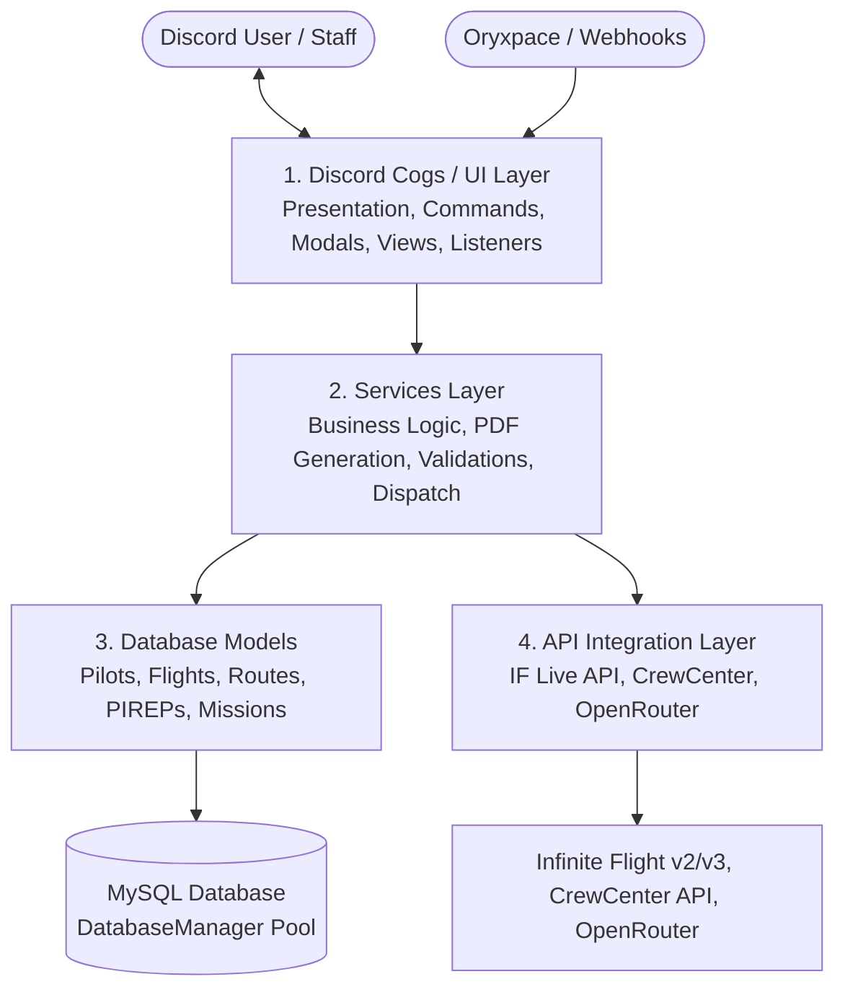

# Oryxie Documentation Hub

Welcome to the central technical documentation for **Oryxie**, the enterprise Discord automation bot for **Qatari Virtual** (Qatar Airways Virtual on the Infinite Flight flight simulator platform).

This documentation provides architectural blueprints, repository navigation, layer boundaries, and development standards for human engineers and automated agents.

---

## 🗺️ Documentation Directory Index

| Document | Description |
| :--- | :--- |
| **[Repository Map](./repository-map.md)** | Comprehensive breakdown of "What is where" across the codebase |
| **[System Architecture](./architecture.md)** | Multi-tier architecture, system context, and component diagrams |
| **[Cogs Architecture & Boundaries](./cogs/overview.md)** | Boundaries, best practices, lifecycle, and anti-patterns for Discord Cogs |
| **[Cogs Catalog](./cogs/catalog.md)** | Detailed directory of all 42 Cog modules organized by domain |
| **[API Layer Overview](./api/overview.md)** | Guidelines, caching rules, and boundaries for external API clients |
| **[Infinite Flight API](./api/infinite-flight.md)** | Infinite Flight Public API v2 & v3 (OAuth2, Live Tracker, Caching rules) |
| **[CrewCenter API](./api/crew-center.md)** | CrewCenter REST API integration & automated PIREP filing |
| **[AI Manager](./api/openrouter-ai.md)** | OpenRouter / OpenAI LLM integration |
| **[Services Layer](./services/overview.md)** | Business logic, calculations, SimBrief, and PDF generation services |
| **[Database & Models](./database/overview.md)** | MySQL connection pool, data access models, and SQL migrations |
| **[Development & Contribution Guide](./development-guide.md)** | Local setup, environment variables, branching strategy, and testing |

---

## 🏛️ Architecture at a Glance

Oryxie follows a strict **four-layer decoupled architecture**:

### Quick Rules of Layer Boundaries

1. **Cogs** handle Discord interactions, permissions, and embeds. **Zero SQL queries or raw external HTTP calls belong in Cogs.**
2. **Services** execute domain logic, coordinate between APIs and Database models, and produce complex artifacts (PDFs, maps). Services never interact with Discord UI directly.
3. **API Managers** communicate asynchronously with external systems. They enforce rate limits and caching policies. They do not format Discord messages.
4. **Database Models** encapsulate parameterized SQL queries using the asynchronous `DatabaseManager` pool.

---

## 🤖 AI Agent Guidelines

If you are an automated AI coding assistant (Antigravity, Cursor, GitHub Copilot, etc.), consult **[`AGENTS.md`](../AGENTS.md)** at the root of this repository before making any code modifications.
