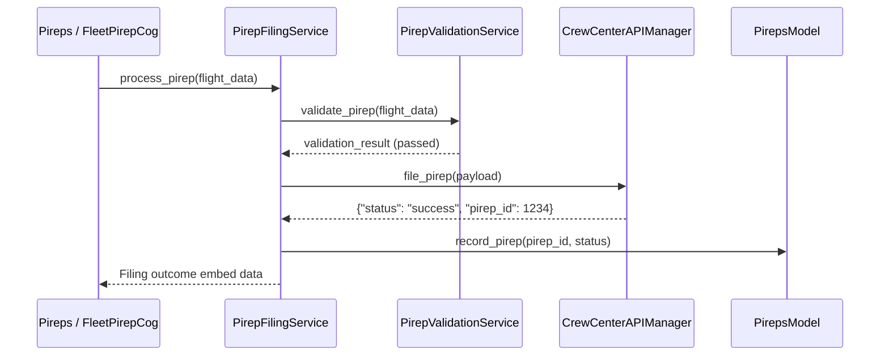

# CrewCenter API Integration

Oryxie connects directly with Qatari Virtual's PHP-based **CrewCenter** web portal to submit flight reports (PIREPs), synchronize pilot rosters, and fetch official operational statistics.

---

## 🌐 Configuration

Defined in `.env`:
```env
CC_API_KEY=your_crewcenter_api_key
CC_API_BASE_URL=https://crewcenter.yourva.com/api
```

---

## 🛠️ API Manager: `CrewCenterAPIManager` (`api/crewcenter_manager.py`)

### Responsibilities
1. **Pilot Information**:
   - `get_pilot(callsign_or_id)`: Fetches pilot profile, flight hours, current rank, and status.
2. **Automated PIREP Filing**:
   - `file_pirep(payload)`: Posts completed flight data (departure, arrival, aircraft, flight time, fuel burned, landing rate) to the CrewCenter backend.
3. **Session Management**:
   - Maintains an asynchronous HTTP session (`aiohttp.ClientSession`) with automatic keep-alive and graceful reconnects.
4. **Error Handling**:
   - Automatically handles non-200 HTTP responses, JSON serialization errors, and authentication failures.

---

## 🔄 Interaction with Services

`CrewCenterAPIManager` is **never called directly by Cogs**. Instead, the workflow flows through `PirepFilingService`:


