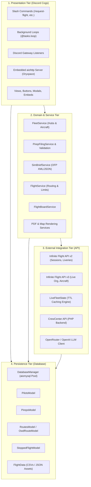
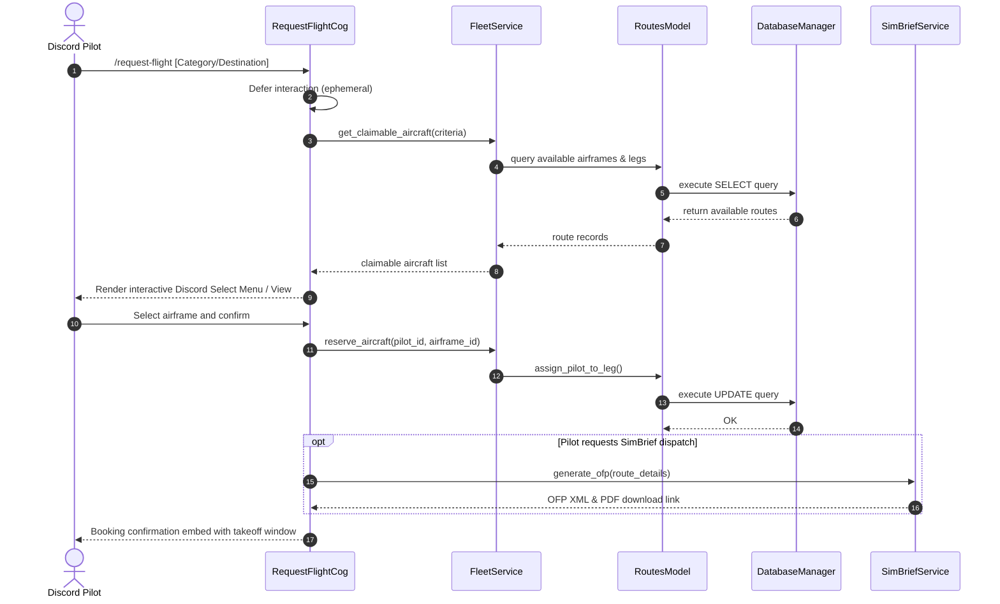
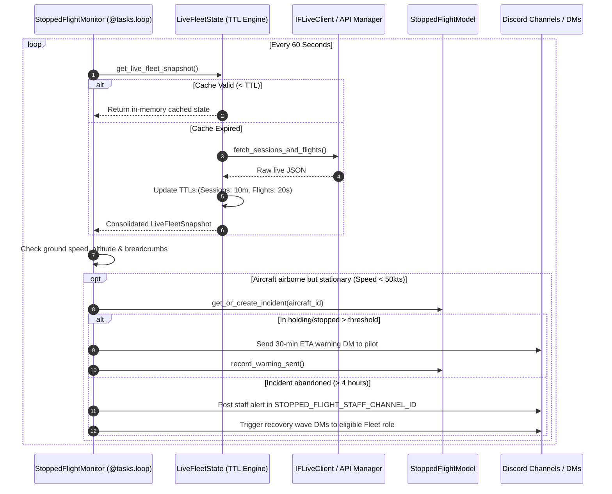

# System Architecture

Oryxie is built around an asynchronous, event-driven, multi-tier architecture. It interfaces with the Discord Gateway API, external flight simulation APIs, and a centralized MySQL database.

---

## 🏗️ Architectural Overview

The system is structured into four primary tiers with strictly enforced boundaries:

---

## 🔄 Core Workflow Sequences

### 1. Flight Booking Workflow (`/request-flight`)

When a pilot books an aircraft:

---

### 2. Live Telemetry & Stopped Flight Monitoring

How Oryxie detects stationary flights and triggers recovery waves without exceeding Infinite Flight API rate limits:

---

## 🔒 Layer Isolation & Dependency Rules

To maintain high stability and testability, components must strictly adhere to the following dependency graph:

1. **Downwards Only**: Upper layers may call lower layers; lower layers must never import or call upper layers.
   - `cogs` $\rightarrow$ `services`, `database`, `api`
   - `services` $\rightarrow$ `database`, `api`, `models`
   - `api` $\rightarrow$ `models` (and auth models in `database`)
   - `database` $\rightarrow$ `models`
2. **Circular Dependency Prevention**:
   - `bot.py` instantiates all managers, services, and models in `setup_hook()`.
   - Dependencies are injected into Cogs via `self.bot` or passed directly to constructors.
   - Never import a Cog from a Service or API module.
3. **Async Everywhere**:
   - Blocking I/O (e.g. `requests`, `time.sleep`, blocking file reading) is forbidden in async event loops.
   - Use `aiohttp` for HTTP, `aiomysql` for DB, `asyncio.sleep` for delays, and `asyncio.to_thread` for CPU-intensive tasks (e.g. ReportLab PDF rendering, matplotlib plotting).
