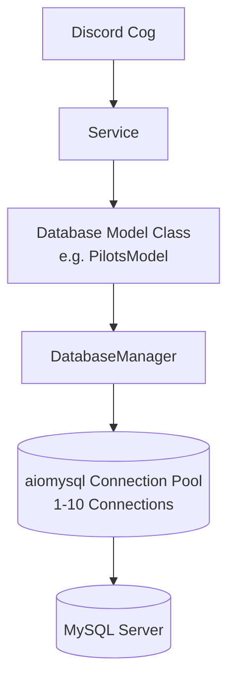

# Database Architecture & Models

Oryxie uses MySQL as its primary persistent relational datastore, managed asynchronously via `aiomysql`.

---

## 🏗️ Architecture & Connection Lifecycle

All database operations are centralized through `DatabaseManager` (`database/manager.py`).



### Connection Pool Configuration
- **Driver**: `aiomysql` with `aiomysql.DictCursor` (returns query rows as Python dicts).
- **Pool Size**: Minimum 1, Maximum 10 connections.
- **Autocommit**: Enabled (`autocommit=True`).
- **Encoding**: `utf8mb4`.

### Self-Healing & Retry Mechanism
In `database/manager.py`, `_execute_query()` implements an automatic 2-attempt retry loop:
1. Verifies if the connection pool is open; reconnects if dead.
2. Catches transient MySQL disconnections or socket resets.
3. Automatically acquires a fresh connection from the pool and retries the query once before propagating an exception.

---

## 🗄️ Database Models

Models in `database/` inherit or receive `DatabaseManager` and encapsulate all table-specific queries:

| Model Class | Source File | Managed Tables / Entities | Purpose |
| :--- | :--- | :--- | :--- |
| `PilotsModel` | `database/pilots_model.py` | `pilots` | Pilot records, Discord IDs, IFC usernames, callsigns, active states |
| `PirepsModel` | `database/pireps_model.py` | `pireps` | Flight logs, block times, status, landing rates |
| `RoutesModel` | `database/routes_model.py` | `routes` | Scheduled routes, origins, destinations, flight numbers, aircraft |
| `OwdRouteModel` | `database/Owd_route_model.py` | `owd_routes` | One-Way / World Discovery special flight routes |
| `FlightBoardModel` | `database/flight_board_model.py` | `flight_board` | Active Discord flight board message IDs and channels |
| `StoppedFlightModel`| `database/stopped_flight_model.py` | `stopped_flight_incidents`, `aircraft_status` | Stalled airborne flight incidents, warnings, recovery waves |
| `ReengagementModel` | `database/reengagement_model.py` | `reengagement_campaigns` | Inactive pilot re-engagement outreach history |
| `ShopModel` | `database/shop_model.py` | `shop_items`, `user_inventory`, `coins` | Virtual economy, store items, purchases |
| `MissionDB` | `database/mission_module.py` | `missions`, `user_missions` | VA missions and pilot completion logs |
| `EventTransactionModel` | `database/event_transaction_model.py` | `event_transactions` | Special event attendance and rewards |
| `RankModel` / `AircraftModel` | `database/va_data_model.py` | `ranks`, `aircraft_requirements`, `multipliers` | VA hierarchy, aircraft rank locks, point multipliers |
| `IFLiveTokensModel` | `database/if_live_tokens_model.py` | `if_live_tokens` | Infinite Flight OAuth2 refresh & access tokens |
| `FlightData` | `database/flight_data.py` | In-memory CSV/JSON | Airport coordinates, runways, and airframe data |

---

## 🛡️ Database Rules & Standards

1. **Parameterize Every Query**:
   - Never concatenate user input directly into SQL strings. Always use `%s` placeholders and pass argument tuples to prevent SQL injection.
   ```python
   # Correct
   query = "SELECT * FROM pilots WHERE callsign = %s AND status = %s"
   args = (callsign, 1)
   return await self.db.fetch_one(query, args)
   ```
2. **No Direct SQL in Cogs or Services**:
   - Every SQL statement must reside in a Model class inside `database/`.
3. **Safe Schema Migrations**:
   - Schema alterations must be placed in `database/*.sql` migration files.
   - Migrations must be non-destructive (`ALTER TABLE ... ADD COLUMN IF NOT EXISTS`, avoiding `DROP TABLE`).
   - If a new feature requires schema changes, document the exact migration script in the feature's documentation and `README.md`.
